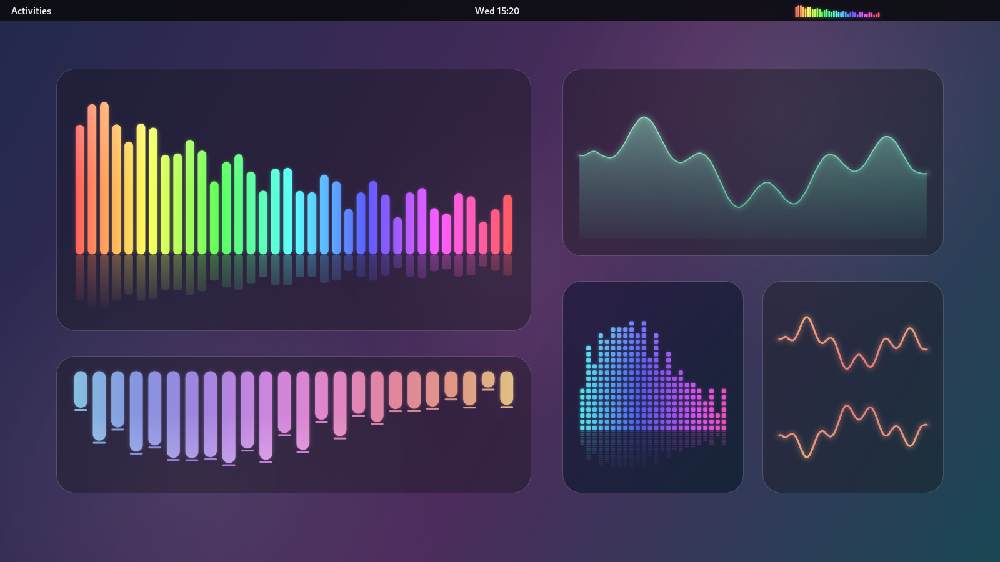

<p align="center">
  
</p>

<h1 align="center">OhAudio-Gnome</h1>

<p align="center">
  A music visualizer for GNOME Shell: in the top bar, on the desktop, or both.<br>
  <a href="#русский">Читать на русском</a>
</p>



I liked [Kurve](https://github.com/luisbocanegra/kurve) on KDE and wanted the same
feeling on GNOME: something small that quietly dances along with whatever is
playing. So here it is. It listens through [CAVA](https://github.com/karlstav/cava)
and draws in the top bar, in a little glass widget on your desktop, or in both
places at once.

*The preview above is drawn by the extension's own rendering code. On a real desktop
the glass also blurs whatever is behind it.*

## What it can do

- **Two places, set up separately.** The top bar and the desktop widget each have
  their own style, colours and effects. Turn on one, the other, or both.
- **Four styles:** bars, blocks (optionally made of little square cubes), a wave and a
  filled wave. Each can grow from the bottom, top, left or right, or mirror out
  from the middle.
- **Colours:** a single colour, a two-colour gradient with a few calm ready-made
  palettes, or a rainbow you can tune: saturation, brightness, how much of the
  spectrum to show, where it starts and how fast it flows.
- **Effects:** soft glow, falling peaks, a shine on the bars and a mirror
  reflection under the widget.
- **The widget's background:** frosted glass, a gradient or nothing at all. Add a
  light and a shadow that come from any direction, a border, rounded corners.
- **Drag it anywhere and resize it** by the corner handles, the same way you'd frame
  a screenshot. Keep it under your windows like a desktop widget, or above them.
- **Knows when to rest.** In silence it doesn't redraw anything. It pauses for
  fullscreen games and videos, and it can hide itself when nothing is playing.
- **Speaks English and Russian.** It follows your system language, and you can pick
  one by hand.
- A switch in the system menu (next to Wi-Fi and sound), so you can always bring it
  back, even with both places turned off.

## Installing

You need **GNOME Shell 50** and **cava**.

```bash
# 1. cava
sudo dnf install cava        # Fedora
sudo apt install cava        # Debian / Ubuntu
sudo pacman -S cava          # Arch

# 2. the extension
git clone https://github.com/delete-read-write/ohaudio-gnome.git
cd ohaudio-gnome
./install.sh
```

> [!IMPORTANT]
> **Log out and back in after installing.** GNOME (on Wayland) only notices a newly
> installed extension in a new session, so the visualizer won't appear until you do.

After logging back in, turn it on:

```bash
gnome-extensions enable ohaudio-gnome@delete-read-write
```

Settings live in the Extensions app, or right-click the desktop widget, or use
*OhAudio → Settings…* in the system menu.

## A few tips

- **Moving the widget:** turn on *Move the widget* (in the system menu or the
  settings), drag it around, pull the handles to resize, then turn it off again.
- **If it feels heavy:** glow and blurred glass cost the most. Lowering the frame
  rate on the *Performance* page helps a lot, and 30 frames per second already looks
  smooth.
- **If you use Blur my Shell** with live blur behind every window, anything animated
  underneath those windows makes them re-blur all the time. Keeping the widget
  above the windows, or limiting the blur to a few apps, takes that load away.
- **Nothing shows up after installing?** Log out and back in first: GNOME only loads
  new extensions in a new session.
- **Nothing moves?** Check that cava is installed and that something is actually
  playing. The *Sound* page lets you pick a specific audio source if *auto* picks
  the wrong one.

## Removing it

```bash
gnome-extensions uninstall ohaudio-gnome@delete-read-write
```

## Thanks

- [CAVA](https://github.com/karlstav/cava) does all the audio analysis.
- [Kurve](https://github.com/luisbocanegra/kurve) for the idea. No code was taken
  from it; this is written from scratch for GNOME.

Licensed under the [GNU GPL v3](LICENSE).

---

<a id="русский"></a>

<h1 align="center">OhAudio-Gnome</h1>

<p align="center">Визуализатор музыки для GNOME Shell: в верхней панели, на рабочем столе или и там и там.</p>

Мне нравился [Kurve](https://github.com/luisbocanegra/kurve) в KDE, и захотелось того же
в GNOME: чего-то небольшого, что тихонько танцует под музыку, которая сейчас играет.
Вот оно. Звук слушает через [CAVA](https://github.com/karlstav/cava), а рисует в верхней
панели, в маленьком стеклянном виджете на рабочем столе или сразу в обоих местах.

*Картинка выше нарисована тем же кодом, что и в расширении. На настоящем рабочем
столе стекло ещё и размывает то, что под ним.*

## Что умеет

- **Два места, настраиваются отдельно.** У панели и у виджета свой стиль, свои цвета и
  эффекты. Включай одно, другое или оба.
- **Четыре стиля:** полосы, блоки (можно собрать из квадратных кубиков), волна и волна
  с заливкой. Растут снизу, сверху, слева или справа, или зеркально от середины.
- **Цвета:** один цвет, градиент из двух цветов с готовыми спокойными палитрами или
  радуга, которую можно подкрутить: насыщенность, яркость, какую часть спектра
  показывать, с какого цвета начинать и как быстро она переливается.
- **Эффекты:** мягкое свечение, падающие пики, блик на полосах и зеркальное отражение
  под виджетом.
- **Фон виджета:** матовое стекло, градиент или вообще ничего. Можно добавить свет и
  тень с любой стороны, рамку, скругление углов.
- **Перетаскивай куда угодно и меняй размер** за уголки, как при выделении области
  для скриншота. Виджет может жить под окнами, как на рабочем столе, или поверх них.
- **Не тратит силы зря.** В тишине ничего не перерисовывает, ставит себя на паузу в
  полноэкранных играх и видео и может прятаться, когда ничего не играет.
- **Говорит по-русски и по-английски.** Язык берётся из системы, но можно выбрать и
  вручную.
- Переключатель в системном меню (рядом с Wi-Fi и звуком), так что его всегда можно
  вернуть, даже если выключить и панель, и виджет.

## Установка

Нужны **GNOME Shell 50** и **cava**.

```bash
# 1. cava
sudo dnf install cava        # Fedora
sudo apt install cava        # Debian / Ubuntu
sudo pacman -S cava          # Arch

# 2. само расширение
git clone https://github.com/delete-read-write/ohaudio-gnome.git
cd ohaudio-gnome
./install.sh
```

> [!IMPORTANT]
> **После установки выйди из сессии и зайди снова.** GNOME (в Wayland) замечает новое
> расширение только в новой сессии, так что до перезахода визуализатор не появится.

Когда зайдёшь снова, включи его:

```bash
gnome-extensions enable ohaudio-gnome@delete-read-write
```

Настройки открываются из приложения «Расширения», правым кликом по виджету или через
*OhAudio → Настройки…* в системном меню.

## Пара советов

- **Как передвинуть виджет:** включи *Двигать виджет* (в системном меню или в
  настройках), перетащи, потяни за уголки, чтобы изменить размер, и выключи обратно.
- **Если тяжело для компьютера:** больше всего стоят свечение и размытое стекло.
  Сильно помогает снизить частоту кадров на вкладке *Производительность*, а 30 кадров
  в секунду и так выглядят плавно.
- **Если стоит Blur my Shell** с живым размытием за каждым окном, любая анимация под
  этими окнами заставляет их размываться заново без остановки. Помогает держать виджет
  поверх окон или оставить размытие только для пары приложений.
- **После установки ничего не появилось?** Сначала перезайди в сессию: GNOME загружает
  новые расширения только в новой сессии.
- **Ничего не двигается?** Проверь, что cava установлена и что что-то действительно
  играет. На вкладке *Звук* можно выбрать конкретный источник, если *auto* хватает
  не тот.

## Удаление

```bash
gnome-extensions uninstall ohaudio-gnome@delete-read-write
```

## Спасибо

- [CAVA](https://github.com/karlstav/cava) за весь анализ звука.
- [Kurve](https://github.com/luisbocanegra/kurve) за идею. Кода оттуда нет, всё написано
  с нуля под GNOME.

Лицензия — [GNU GPL v3](LICENSE).
